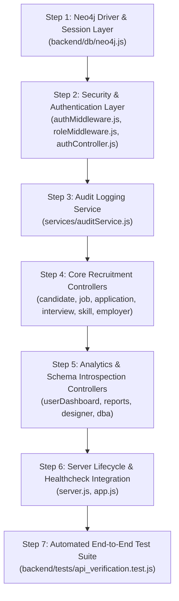

# Phase 3 Implementation Plan: Backend Migration from Oracle to Neo4j

**Project:** Job Recruitment Management System (JRMS) Modernization  
**Document Version:** 1.0 (Implementation Roadmap & Specifications)  
**Date:** 2026-10-15  
**Target Directory:** `/Users/divyam/Desktop/Langauges/C++/job-recruitment-management-system-neo4j`  
**Reference Design Documents:**  
- [`docs/PHASE_2A_REVIEW.md`](./PHASE_2A_REVIEW.md) (Approved Phase 2A Design Validation Pass)  
- [`docs/SCHEMA_MAPPING.md`](./SCHEMA_MAPPING.md) (43-Table Relational-to-Graph Mapping)  
- [`docs/GRAPH_DATA_MODEL.md`](./GRAPH_DATA_MODEL.md) (Entity Specifications, Labels, Properties, Constraints)  
- [`docs/PHASE_2_REPORT.md`](./PHASE_2_REPORT.md) (Phase 2 Execution Report: 56/56 Passing Parity Tests)  
- [`docs/NEO4J_SETUP_AND_MIGRATION_GUIDE.md`](./NEO4J_SETUP_AND_MIGRATION_GUIDE.md) (Environment & Operations Guide)  

---

## 1. Overview and Objectives

Phase 3 transitions the backend application from Oracle Database 23c Free (and its in-memory simulation fallback) to the running, verified Neo4j 5.26 property graph instance.

### Mandatory Boundaries & Safeguards:
1. **Isolated Execution:** All modifications occur strictly in `/Users/divyam/Desktop/Langauges/C++/job-recruitment-management-system-neo4j`. The original repository `SAUBHGYA7/job-recruitment-management-system` is strictly read-only.
2. **Zero Remote Operations:** No Git commits, remotes, branches, or pushes will be executed.
3. **No Frontend or Oracle File Deletions:** Frontend code remains untouched. Oracle files (`backend/db/oracle.js`, `backend/db/inMemoryDb.js`, `backend/db/seedData.js`, `database/schema.sql`, `database/seed.sql`) remain in place for reference and audit history.
4. **API Contract Compatibility:** All existing HTTP methods, URL endpoints, request payload schemas, and response JSON formats will be maintained so existing clients and UI components function seamlessly.

---

## 2. Step-by-Step Implementation Roadmap



### Step 1: Database Access Layer (`backend/db/neo4j.js`)
- Implement a reusable driver management module using `neo4j-driver`.
- Environment variable configuration: `NEO4J_URI`, `NEO4J_USER`, `NEO4J_PASSWORD`, `NEO4J_DATABASE`.
- Singleton driver initialized with `{ disableLosslessIntegers: true }`.
- Helper functions:
  - `runQuery(cypher, params)`: Automatic session creation, query execution, record extraction, and session closure.
  - `readTransaction(fn)` / `writeTransaction(fn)`: Scoped transaction helpers.
  - `getDbStatus()`: Returns live connectivity, engine version, and latency for `/api/health`.
  - `closeNeo4jDriver()`: Graceful pool teardown on shutdown.

### Step 2: Authentication & Authorization Hardening
- **`backend/middleware/authMiddleware.js`:**
  - Verify JWT tokens with `JWT_SECRET`.
  - Lookup authenticated user in Neo4j via `MATCH (u:AppUser {user_id: $userId}) RETURN u`.
  - Check account active status (`u.is_active == 1`).
  - Attach `req.user` (`{ userId, username, fullName, email, role, isActive }`).
- **`backend/controllers/authController.js`:**
  - `login`: Fetch user from Neo4j; verify password using `bcrypt.compare(password, user.password_hash)`.
  - Abolish hardcoded demo cleartext password maps.
  - Issue JWT token with claims (`userId`, `username`, `role`, `fullName`).
  - Audit log successful and failed attempts.
  - `getCurrentUser`: Return sanitized `req.user`.
  - `logout`: Log audit event and return confirmation.

### Step 3: Audit Logging Service (`backend/services/auditService.js`)
- `logAuditEvent({ username, role, action, details, ipAddress })`:
  - Execute parameterized Cypher:
    ```cypher
    MATCH (m:AuditLog)
    WITH coalesce(max(m.log_id), 0) + 1 AS nextId
    CREATE (al:AuditLog {
      log_id: nextId,
      username: $username,
      role: $role,
      action: $action,
      details: $details,
      ip_address: $ipAddress,
      created_at: $timestamp
    })
    ```
- `getAuditLogs(limit)`:
  - Query most recent logs: `MATCH (al:AuditLog) RETURN al ORDER BY al.log_id DESC LIMIT $limit`.

### Step 4: Core Recruitment Business Controllers
1. **`backend/controllers/candidateController.js`:**
   - `getCandidates`: Query `(:Candidate)` with optional joins on `(:Education)` and `(:Application)`. Filter by gender, search term (fname, lname, city, specialization). Return matching JSON format with `address`, `emails`, `phones`, `education`, `application`.
   - `getCandidateById`: Retrieve full graph profile: Candidate, Address, Emails, Phones, Education, Application, Dependent, Interview, Skills (`[:HAS_SKILL]`), Experience (`[:HAS_EXPERIENCE]`), Applied Jobs (`[:APPLIED_FOR]`).
   - `createCandidate`: Calculate next `cand_id`, create node with properties and multi-valued arrays, connect `HAS_EDUCATION`, `SUBMITTED_APPLICATION`, `HAS_DEPENDENT`, `HAS_INTERVIEW`.
   - `updateCandidate`: Update candidate scalar and array properties, update address, update relationship targets.
   - `deleteCandidate`: Detach and delete `(:Candidate)` node.
2. **`backend/controllers/jobController.js`:**
   - `getJobs`: Match `(:Job)`, optional match `[:REQUIRES]->(:Skill)`, calculate applicant count via `COUNT { MATCH (:Candidate)-[:APPLIED_FOR]->(j) }`.
   - `getJobById`: Retrieve job with required skills.
   - `createJob`, `updateJob`, `deleteJob`: Full Cypher CRUD.
3. **`backend/controllers/applicationController.js`:**
   - `getApplications`: Match `(:Application)`, optional match `(:Candidate)-[:SUBMITTED_APPLICATION]->(a)`, optional match `(a)-[:FOR_JOB]->(:Job)`.
   - **Reconciliation Transparency:** All 25 applications (including `APP021`–`APP025`) are connected to their target jobs. Note that `APP021`–`APP025` were reconciled via candidate applications in `Applies` rather than legacy `Job_Details`.
   - `createApplication`: Create `(:Application)`, link candidate via `SUBMITTED_APPLICATION`, link job via `FOR_JOB`.
   - `updateApplicationStatus`, `deleteApplication`: Status update and delete operations.
4. **`backend/controllers/interviewController.js`:**
   - `getInterviews`: Match `(:Interview)` with optional candidate link. Filter by mode and search keyword.
   - `createInterview`, `updateInterview`, `deleteInterview`: Cypher CRUD operations.
5. **`backend/controllers/skillController.js`:**
   - `getSkills`: Match `(:Skill)`, calculate demand count (`COUNT { MATCH ()-[:REQUIRES]->(s) }`) and candidate count (`COUNT { MATCH ()-[:HAS_SKILL]->(s) }`).
   - `createSkill`, `updateSkill`, `deleteSkill`: Cypher CRUD operations.
6. **`backend/controllers/employerController.js`:**
   - `getEmployers`: Match `(:Employer)` with optional `[:AFFILIATED_WITH]->(:Company)` and `[:CONTRACTS_AGENCY]->(:RecruitmentAgency)`. Native `phones` list preserved.
   - `createEmployer`, `updateEmployer`, `deleteEmployer`: Cypher CRUD operations.

### Step 5: Dashboard, Analytics, and Administrative Controllers
1. **`backend/controllers/userDashboardController.js`:**
   - Fast graph aggregations for KPIs: total candidates, jobs, open jobs, applications, interviews, employers.
   - Applications by status, jobs by status, interviews by status, most demanded skills, recent 5 applications.
2. **`backend/controllers/reportsController.js`:**
   - HR user reports (applications report, skill demand vs supply gap, job compensation).
   - Designer schema reports (table/label metadata, property counts, constraint counts).
   - DBA activity reports (role distribution, system logs).
3. **`backend/controllers/designerController.js`:**
   - Graph schema introspection (`SHOW CONSTRAINTS`, `SHOW INDEXES`, `db.labels()`, `db.relationshipTypes()`).
   - Dynamic mapping of node labels and relationships into table representations for schema viewer compatibility.
   - Preserves the educational BCNF decomposition guide.
4. **`backend/controllers/dbaController.js`:**
   - DBA system health dashboard.
   - User administration (`getUsers`, `createUser`, `updateUserRole`, `toggleUserStatus`) on `(:AppUser)` nodes with Bcrypt password hashing.
   - Index and constraint health inspection (`SHOW CONSTRAINTS`, `SHOW INDEXES`).
   - **DBA Console Security:** Reject arbitrary mutating Cypher. Implement allowlisted query templates (`LIST_CANDIDATES`, `SEARCH_JOBS`, `SCHEMA_CONSTRAINTS_HEALTH`, `AUDIT_LOG_STREAM`, `RELATIONSHIP_DEGREE_SUMMARY`) with strict parameter validation. All read queries run via `session.executeRead()` under `requireRole('DBA')`.

### Step 6: Server & Healthcheck Lifecycle (`server.js`, `app.js`)
- Update `backend/server.js` to initialize the Neo4j driver (`initNeo4jDriver()`) on startup and attach graceful shutdown listeners (`SIGINT`, `SIGTERM`).
- Update `GET /api/health` in `backend/app.js` to return live Neo4j database health status.

### Step 7: Automated End-to-End Test Suite (`backend/tests/api_verification.test.js`)
Implement an automated integration test runner executing HTTP requests against all migrated routes:
1. Database connectivity & health verification.
2. Authentication (valid credentials, invalid passwords, non-existent accounts, deactivated accounts).
3. Role-based authorization enforcement (`USER`, `DATABASE_DESIGNER`, `DBA`).
4. Candidate CRUD, search, filtering, and nested profile responses.
5. Job CRUD, required skills, and applicant counts.
6. Application CRUD and 25-application reconciliation verification (`APP021`–`APP025`).
7. Interview, Skill, Employer CRUD.
8. Dashboard KPI aggregations and analytics reports.
9. DBA query console allowlist execution and mutation blocking.

---

## 3. Security Boundary Summary

| Security Layer | Mechanism | Implementation |
| :--- | :--- | :--- |
| **Authentication** | JWT + Bcrypt | Passwords hashed with salt rounds $\ge 10$; verified with `bcrypt.compare`. No fallback plain-text maps. |
| **Authorization** | Server-side RBAC | `requireRole('USER', 'DATABASE_DESIGNER', 'DBA')` enforced in Express middleware on every route. |
| **DBA Query Console** | Template Allowlisting | Arbitrary Cypher execution disabled; only approved query templates with validated parameters permitted. |
| **Driver Isolation** | Read transactions | Read-only console exploration wrapped in `session.executeRead()` with mutation clause rejections. |
| **Audit Trails** | Immutable logging | All logins, logouts, administrative actions, and data mutations logged to `(:AuditLog)`. |
| **Error Handling** | Sanitized responses | Bolt connection strings, database credentials, and internal stack traces are suppressed in API responses. |
